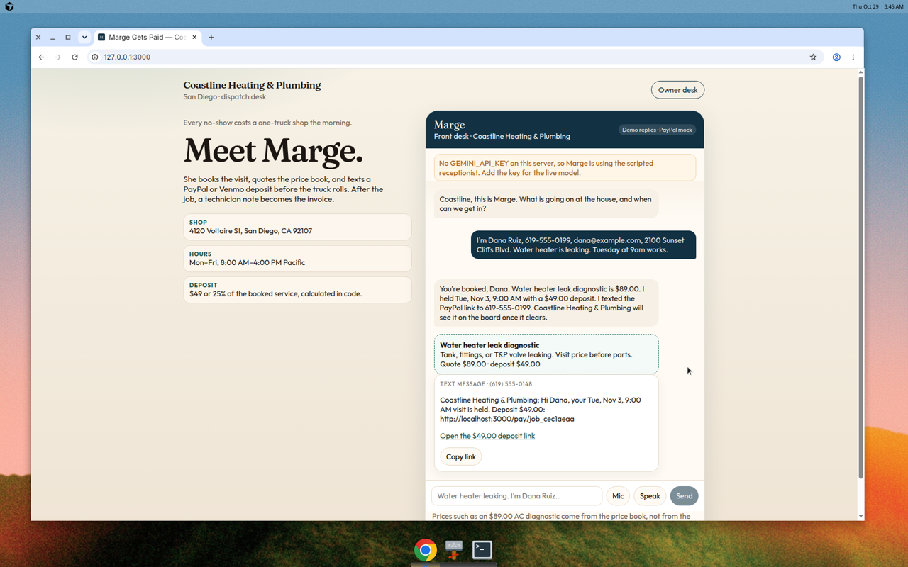
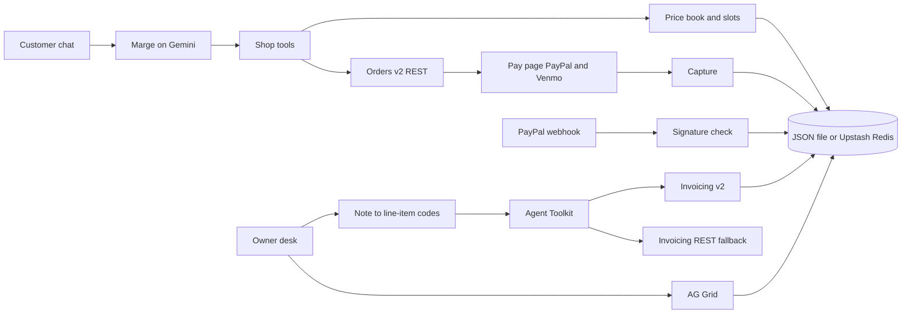
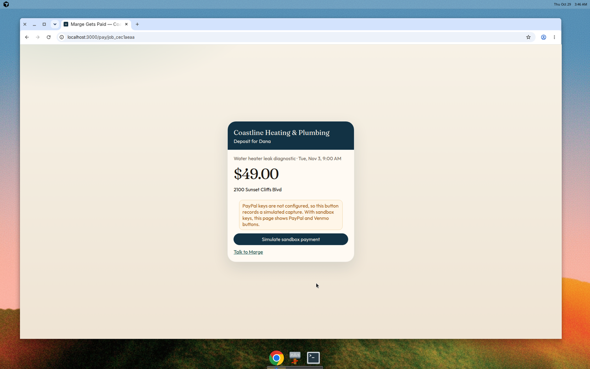
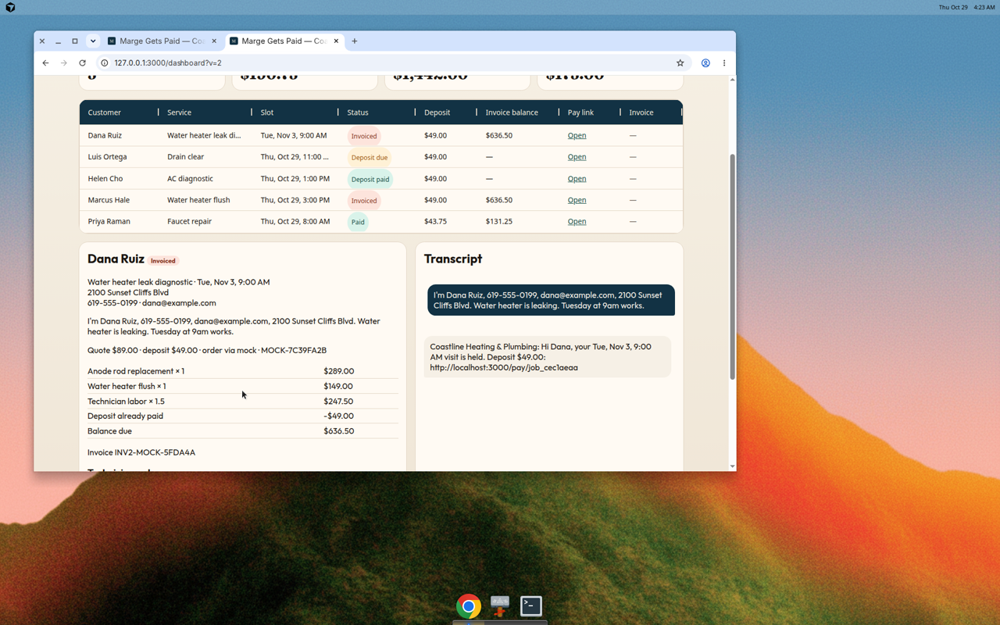

# Marge Gets Paid

An AI receptionist for a one-truck HVAC and plumbing shop. She books the visit, takes a PayPal or Venmo deposit, and invoices after the job, so no-shows and late payments drop.

**Coastline Heating & Plumbing, San Diego.** A missed morning is roughly a $89–$149 diagnostic plus the jobs that would have followed it. Marge will not put a truck on the schedule until the deposit order exists.

This repo was written in October 2026 for the PayPal AI Hackathon. It does not reuse an older codebase. It stays free to run through 15 December 2026 on Vercel Hobby, the PayPal sandbox, and a free Gemini key.

Live demo: add the Vercel URL here after deploy.



## The 60-second judge path

1. Open `/` and tell Marge: "I'm Dana Ruiz, 619-555-0199, dana@example.com, 2100 Sunset Cliffs Blvd. My water heater is leaking. Tuesday at 9am works."
2. Open the link in the text-message bubble. Pay the $49 deposit with the sandbox buyer below. PayPal and Venmo buttons both render.
3. Open `/dashboard` (password `coastline` unless you set `DASHBOARD_PASSWORD`). The row reads Deposit paid.
4. Select the job, paste `replaced anode rod, flushed tank, 1.5 hr`, and click **Mark complete and invoice**.
5. Pay that invoice in the sandbox. The row reads Paid. **Reset demo** restores the sample board.

The shoot sheet for the YouTube video is [demo-script.md](demo-script.md). Keep it under 3:00, with no copyrighted music.

## How PayPal is used

| Piece | What it does |
| --- | --- |
| OAuth 2.0 client credentials | Sandbox access token for every server call |
| Orders v2 `POST /v2/checkout/orders` | Deposit order, `intent: CAPTURE`, `custom_id` = job id, amount computed in code |
| Orders v2 capture | The pay page captures the approved order. `ORDER_ALREADY_CAPTURED` is treated as success |
| PayPal JS SDK | Buttons on `/pay/[jobId]` with `enable-funding=venmo` |
| Invoicing v2 create + send | Balance due after the visit, deposit credited as a line discount |
| Webhooks | `POST /api/paypal/webhook` calls `POST /v1/notifications/verify-webhook-signature` |
| `@paypal/agent-toolkit` | Marge's `create_invoice` and `send_invoice` tools call the toolkit's AI SDK tools. If that call fails, the same payload goes to the Invoicing REST API |

The toolkit's `create_order` tool cannot set `custom_id`. Deposit orders therefore go through Orders v2 directly so the webhook can match the job. Amounts are calculated in `lib/money.ts` from the price book. The model only chooses a service code, a slot, and later the line-item codes and quantities.

Events that move a job to **Deposit paid**: `CHECKOUT.ORDER.APPROVED`, `CHECKOUT.ORDER.COMPLETED`, `PAYMENT.CAPTURE.COMPLETED`. `INVOICING.INVOICE.PAID` moves it to **Paid**. Event ids are stored, so a second delivery is a no-op. The pay page also records the capture, so the demo still finishes if the webhook is slow.

Without sandbox keys, the app uses an in-process mock at the same gateway boundary (`PAYPAL_FORCE_MOCK=1` forces it). The pay page says so. `npm test` uses that mock.

## How AI is used

Marge is a tool-calling receptionist on the Vercel AI SDK (`ai`, `@ai-sdk/google`, `@ai-sdk/react`) and Gemini (`gemini-2.5-flash`, override with `GEMINI_MODEL`).

Customer tools:

- `list_open_slots` — seeded openings in America/Los_Angeles
- `quote_service` — price-book lookup. The model cannot pass a price
- `book_job` — name, phone, email, address, issue, service code, slot
- `create_deposit_order` — job id only. The server sets the amount and creates the PayPal order

After the visit, a second Gemini call has three tools: `propose_line_items` (codes and quantities only), `create_invoice`, and `send_invoice`. `create_invoice` prices the lines and calls the Agent Toolkit. If Gemini is down, keyword matching on the technician note still builds the same priced invoice.

With no `GEMINI_API_KEY`, the chat uses a scripted receptionist that calls those same booking functions. The page labels that mode. Judges should set the key so the model drives the conversation.

Optional: the chat has a mic (browser speech-to-text) and a speak toggle (speech synthesis). No paid telephony. The "text" is a message bubble with a copyable link.

### AI tools to list on Devpost

- **Google Gemini** (`gemini-2.5-flash`) via the **Vercel AI SDK**, for the receptionist and for turning a technician note into price-book codes
- **PayPal Agent Toolkit** (`@paypal/agent-toolkit`, AI SDK adapter) for `create_invoice` and `send_invoice`
- **AG Grid Community** for the owner board (sponsor tool)
- **Cursor cloud agent (Grok 4.7)** wrote this repository in October 2026
- Browser **Web Speech API** is an optional input on the chat. It is not a model

## Architecture



Job states: `new → booked → deposit_pending → deposit_paid → completed → invoiced → paid`, plus `cancelled`.

## Screens





## Run it locally

Node 20 or newer.

```bash
cp .env.example .env.local
# fill PayPal sandbox keys, GEMINI_API_KEY, and NEXT_PUBLIC_PAYPAL_CLIENT_ID
npm install
npm test
npm run dev
```

Open http://localhost:3000 and http://localhost:3000/dashboard.

`npm test` does not call PayPal or Gemini. `npm run build` produces the Vercel build.

### Verify the real sandbox

`scripts/verify-sandbox.mjs` is a standalone Node script. It does not print secrets. It runs OAuth, creates a $49 order, creates and sends an invoice, and asks Gemini to turn a technician note into price-book codes. Each step prints `PASS` or `FAIL`.

```bash
export PAYPAL_SANDBOX_CLIENT_ID=...
export PAYPAL_SANDBOX_CLIENT_SECRET=...
export GEMINI_API_KEY=...
export PAYPAL_SANDBOX_BUYER_EMAIL=sb-your-buyer@personal.example.com
node scripts/verify-sandbox.mjs
```

The invoice is a real sandbox invoice emailed to `PAYPAL_SANDBOX_BUYER_EMAIL` (or `buyer@example.com` if that is unset). Exit code 0 means every step passed.

## Environment

| Variable | Required | Purpose |
| --- | --- | --- |
| `PAYPAL_SANDBOX_CLIENT_ID` | Yes, for live sandbox | Sandbox REST app client id. `PAYPAL_CLIENT_ID` is an alias |
| `PAYPAL_SANDBOX_CLIENT_SECRET` | Yes, for live sandbox | Sandbox secret. `PAYPAL_CLIENT_SECRET` is an alias |
| `NEXT_PUBLIC_PAYPAL_CLIENT_ID` | Yes, for the buttons | Same client id, for the JS SDK. The pay page also reads it at runtime from `/api/paypal/config` |
| `PAYPAL_ENV` | | `sandbox` |
| `PAYPAL_WEBHOOK_ID` | Yes, after deploy | From the sandbox webhook. Without it, signature verification rejects events. The pay page capture still updates the job |
| `GEMINI_API_KEY` | Yes, for the live model | Google AI Studio key. `GOOGLE_GENERATIVE_AI_API_KEY` is an alias |
| `GEMINI_MODEL` | | Default `gemini-2.5-flash` |
| `DASHBOARD_PASSWORD` | | Owner desk password. Unset means `coastline` |
| `APP_BASE_URL` | Yes, in production | Public origin used in the deposit link, for example `https://marge-gets-paid.vercel.app` |
| `PAYPAL_SANDBOX_BUYER_EMAIL` | For the verify script | Sandbox personal account that receives the invoice |
| `UPSTASH_REDIS_REST_URL` | On Vercel | Upstash Redis REST URL. `KV_REST_API_URL` is an alias |
| `UPSTASH_REDIS_REST_TOKEN` | On Vercel | Upstash token. `KV_REST_API_TOKEN` is an alias |
| `PAYPAL_FORCE_MOCK` | | Set to `1` to force the mock gateway |

Local dev stores jobs in `data/store.json` (gitignored). Vercel's filesystem does not keep that file across requests. Connect free Upstash Redis before judges use the deployment. There is no Postgres dependency.

## Sandbox buyer

PayPal sandbox buyers belong to the developer account. This repo cannot ship a working password. Before you submit on Devpost, create or open the personal account and paste it here:

| | |
| --- | --- |
| Buyer email | `sb-________________@personal.example.com` |
| Buyer password | `(show it in the dashboard, then paste it)` |
| Where | [developer.paypal.com/dashboard/accounts](https://developer.paypal.com/dashboard/accounts) → Sandbox → Accounts → **Personal** → View/edit |

Judges pay with that personal account, not a live PayPal login. The sandbox **business** account owns the REST app and receives the money. Use a US buyer if you want the Venmo button to appear. The PayPal button is the reliable path either way.

Sample rows already on the owner desk (Luis, Helen, Marcus, Priya) are labeled mock. They are there so the grid is not empty. A live charge starts with a new chat.

## Webhook setup

Do this after the first successful Vercel deploy, because the URL has to exist.

1. PayPal Developer → Apps & Credentials → Sandbox → your app → Webhooks → Add webhook.
2. URL: `https://YOUR_DOMAIN/api/paypal/webhook`
3. Events: `CHECKOUT.ORDER.APPROVED`, `CHECKOUT.ORDER.COMPLETED`, `PAYMENT.CAPTURE.COMPLETED`, `INVOICING.INVOICE.PAID`.
4. Copy the webhook id into `PAYPAL_WEBHOOK_ID` and redeploy.
5. Pay a deposit. The row should move to Deposit paid even if you never refresh, within a few seconds. The grid polls. The pay page capture is the backup.

Signature failures return 401 and do not store the event id, so PayPal can retry. A verified duplicate returns 200 and does not change the job twice.

## Deploy on Vercel Hobby

1. Import this GitHub repo as a Next.js project on the Hobby plan.
2. Add the environment variables from the table. Point `APP_BASE_URL` at the deployment origin.
3. Storage → Create database → Upstash Redis (free). Accept the injected `KV_REST_API_URL` and `KV_REST_API_TOKEN`, or copy the REST URL and token into the `UPSTASH_REDIS_REST_*` names.
4. Deploy. Open `/`, book a job, and pay with the sandbox buyer.
5. Register the webhook (above) and redeploy with `PAYPAL_WEBHOOK_ID`.
6. From your laptop, run `node scripts/verify-sandbox.mjs` with the same three secrets.
7. Paste the buyer email and password into this README, record the video from [demo-script.md](demo-script.md), and submit on Devpost before **12:00 PM Pacific on 12 November 2026**. Leave the deployment up through 15 December 2026.

`next build` is the production build. No paid Vercel features are required.

## Price book

Deposits are either **$49** or **25%** of the booked service. Examples: AC diagnostic $89 / $49 deposit, water heater flush $149 / $49, drain clear $129 / $49, AC tune-up $189 / 25%. Labor is $165 an hour and is invoiced after the visit. The full list is `lib/price-book.ts`.

## License

MIT. See [LICENSE](LICENSE).
